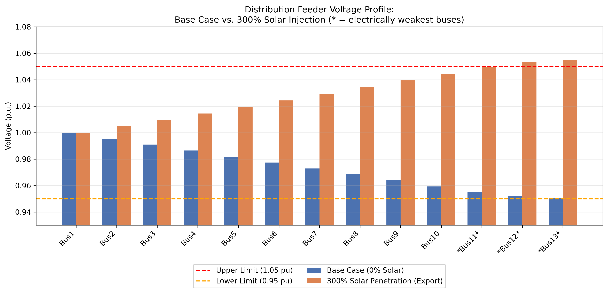
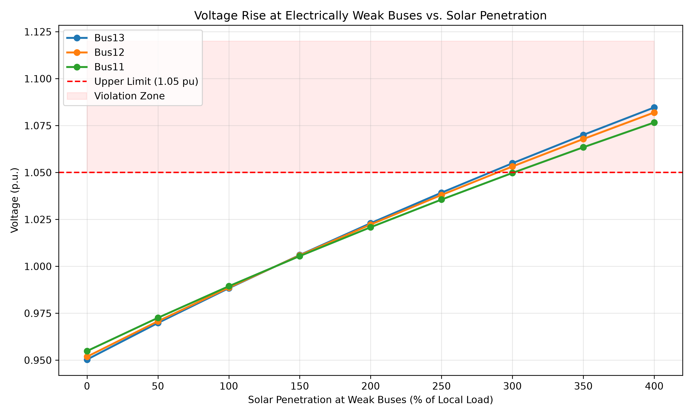

# Distribution Feeder Solar Hosting Capacity Assessment

**Author:** [Chinmay Mehta] · [wiz-forge]

## Overview
This project simulates a radial distribution feeder to assess how much
rooftop solar PV it can host before voltage limits are violated. Using a
Python-based power flow model, the study identifies the feeder's
electrically weakest buses, injects rooftop solar as a penetration sweep
(0–400% of local load), and determines the point at which voltage exceeds
the statutory 1.05 pu upper limit — a key question distribution utilities
must answer before approving new solar interconnection requests.

## Key Finding
> **This feeder's hosting capacity is approximately 250–300% of local
> load at its electrically weakest buses** (sweep resolution: 50% steps).
> Beyond this threshold, midday solar export drives voltage above the
> 1.05 pu statutory limit at Bus13, the feeder's tail-end bus. Voltage
> regulation equipment (smart inverter Volt-VAR control, capacitor banks,
> or OLTC adjustment) would be required to support higher penetration.

## Methodology
1. **Base Case Power Flow** — Solve a 13-bus radial feeder under normal
   loading and confirm all buses are within the 0.95–1.05 pu limit.
2. **Weak Bus Identification** — Identify the 3 buses with the lowest
   base-case voltage (typically the feeder's electrical tail end).
3. **Solar Penetration Sweep** — Inject rooftop solar as a negative PQ
   load at the weak buses, sweeping from 0% to 400% of each bus's local
   load, re-solving the power flow at each step.
4. **Violation Detection** — Identify the first penetration level at
   which any bus exceeds the 1.05 pu upper limit.

## Model Validation
Two independent power flow backends (OpenDSS and pandapower) were built
using identical feeder topology and parameters, and cross-checked against
a physical sanity check: at exactly 100% solar penetration, net real
power at the affected buses is zero, so voltage should remain at or
slightly below the source reference — it should never exceed it.

- **pandapower**: ~0.988 pu at 100% penetration → passes the check ✅
- **OpenDSS**: ~1.055 pu at 100% penetration → fails the check ❌

Based on this validation, **pandapower is used as the authoritative
backend** for all results reported here. The OpenDSS implementation is
retained in the codebase for transparency and future debugging.

## Visualizations

**Voltage Profile: Base Case vs. High Solar Penetration**


**Voltage Rise at Weak Buses vs. Solar Penetration**


## Model Assumptions
- This is a **synthetic, illustrative 13-bus radial feeder** inspired by
  standard distribution feeder conventions — not an exact replica of the
  official IEEE 13-bus test case.
- Solar PV is modeled as a simplified negative constant-power (PQ) load,
  not a full inverter-based PVSystem model — a standard simplification
  for rapid hosting-capacity screening studies.
- Feeder impedance and loading values are illustrative, tuned to produce
  a realistic voltage-drop profile typical of a rural/suburban MV feeder.

## Tools Used
- Python 3.x
- pandapower (validated power flow backend)
- opendssdirect.py (secondary backend, retained for reference)
- Pandas, NumPy, Matplotlib

## How to Run
```bash
pip install -r requirements.txt
python main.py
```

## Output Files
- `solar_hosting_capacity_results.csv` — full voltage results table
- `plot1_voltage_profile.png` — base case vs. high-penetration comparison
- `plot2_weak_buses.png` — voltage trajectory at weak buses across sweep

## Relevance
This methodology mirrors a real, active challenge for distribution
utilities integrating rising rooftop solar adoption: determining feeder
hosting capacity to screen interconnection requests without triggering
costly, reactive infrastructure upgrades.